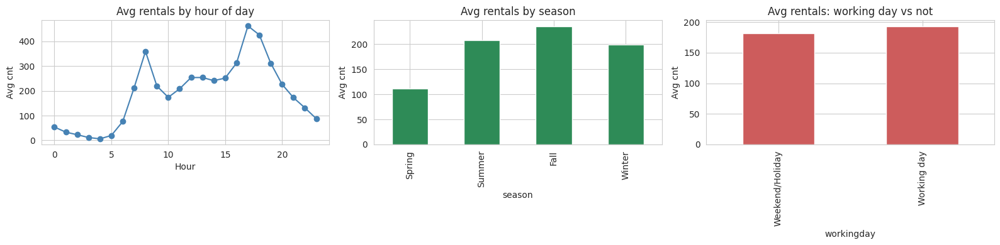
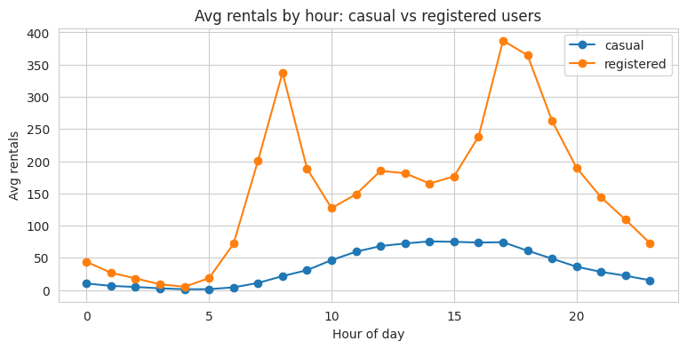
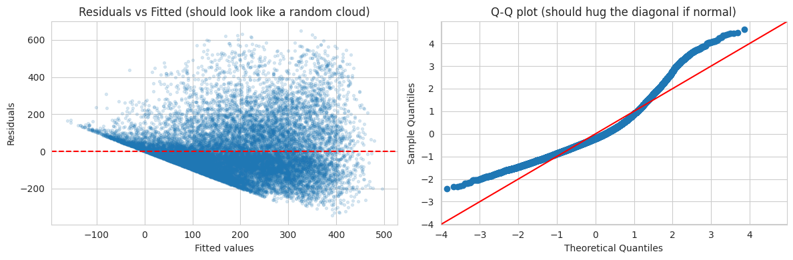
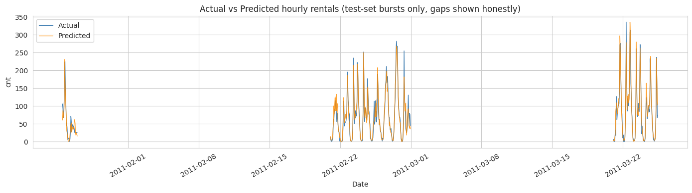
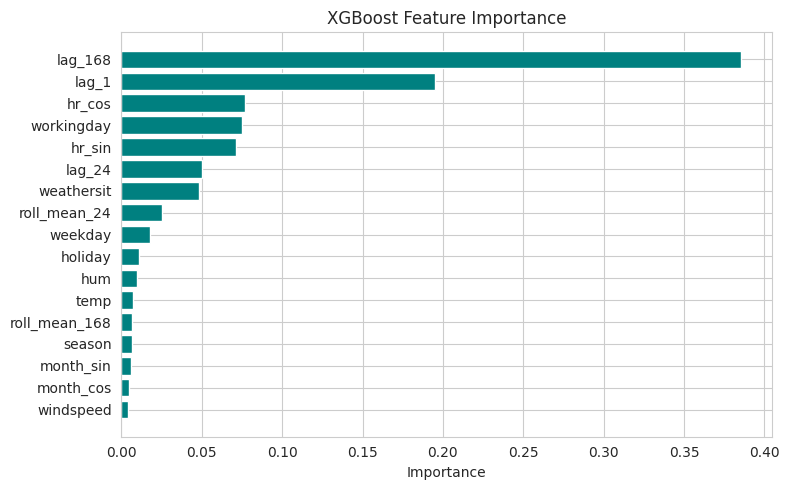
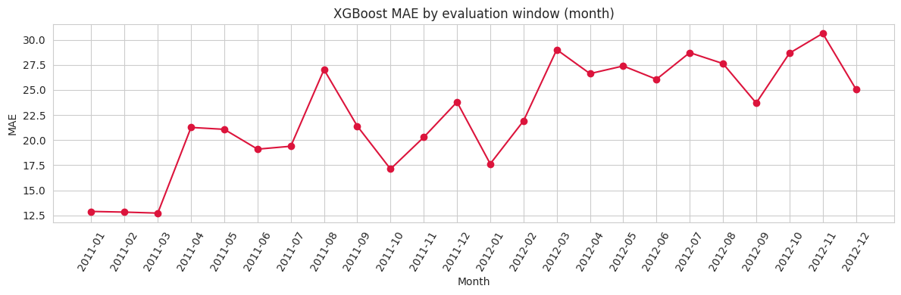

# Capital Bikeshare Demand Analysis and Forecasting

An end-to-end analysis of hourly bike-sharing demand in Washington, D.C. The project moves from exploratory analysis, to statistical regression, to leakage-safe demand forecasting, and compares a gradient-boosted model against simple baselines.

> **Dataset not included.** Download `hour.csv` yourself from the [UCI Bike Sharing Dataset](https://archive.ics.uci.edu/dataset/275/bike+sharing+dataset) and place it next to the notebook (see "How to run" below).

## What this project does

1. **Exploratory analysis.** Hourly, seasonal, weather, and user-type (casual vs. registered) patterns, plus data quality checks (165 hours are missing from the two-year record).
2. **Regression analysis.** OLS baseline, multicollinearity check (VIF), residual diagnostics, overdispersion test, and a Negative Binomial regression suited to count data.
3. **Forecasting.** XGBoost with lag, rolling, and cyclical time features, evaluated on a custom split (days 1 to 20 of each month for training, day 21 to month end for testing), with lookahead leakage explicitly prevented.

## Key results

| Model | MAE | RMSE | R-squared |
|---|---|---|---|
| Naive (same hour, last week) | 59.1 | 101.9 | 0.69 |
| Linear Regression | 44.7 | 68.6 | 0.86 |
| **XGBoost** | **22.9** | **36.8** | **0.96** |

Main findings:
- Registered users (81% of rentals) ride mostly as commuters, with peaks near 8 AM and 6 PM. Casual users ride mostly on weekends.
- Rental counts are heavily overdispersed (variance is about 174 times the mean), so a Negative Binomial model is more appropriate than OLS.
- Temperature has the largest positive effect on demand and humidity the largest negative effect.
- The forecasting model relies mostly on weekly repetition (the same hour one week earlier alone accounts for about 42% of feature importance), so it may react slowly to unusual weather.

## Figures

| | |
|---|---|
|  |  |
|  |  |
|  |  |

## Repository contents

| Path | Description |
|---|---|
| `bikeshare_analysis.ipynb` | Annotated notebook covering EDA, regression, and forecasting |
| `reports/research_summary_report.pdf` | Written summary of methods, results, and discussion |
| `figures/` | Figures used in this README |
| `requirements.txt` | Python dependencies |

## How to run

```bash
# 1. Clone this repository
git clone https://github.com/<your-username>/bikeshare-demand-forecasting.git
cd bikeshare-demand-forecasting

# 2. (Optional) create a virtual environment
python -m venv .venv
.venv\Scripts\activate          # Windows
# source .venv/bin/activate     # macOS / Linux

# 3. Install dependencies
pip install -r requirements.txt

# 4. Download hour.csv from the UCI link above and place it in this folder

# 5. Launch Jupyter and run all cells
jupyter notebook
```

## Notes on method

- `hour.csv` is used because the task is an hourly forecast; `day.csv` has already aggregated away the hourly information.
- Weather columns in the source data are pre-normalized to a 0 to 1 scale.
- Missing hours are exposed by reindexing to a complete hourly timeline. Gaps of six hours or less are forward-filled using only past values, and longer gaps are excluded.
- All lag and rolling features use only information available before the prediction hour.

## License

Add a license of your choice (for example MIT) before sharing publicly. The dataset has its own terms, see the UCI page.
